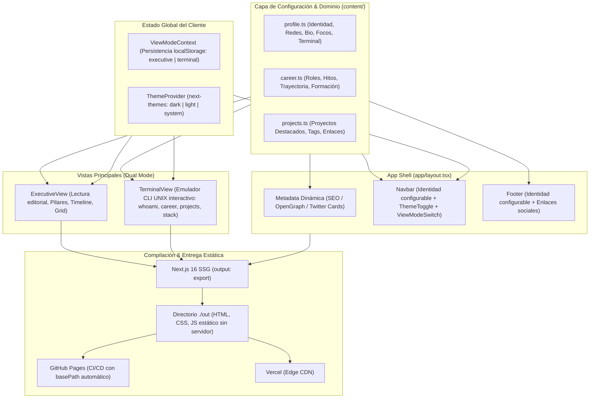

# Arquitectura Técnica del Sistema

Este documento describe la arquitectura global, el modelo de datos, los flujos de renderizado y las decisiones estructurales del proyecto **Personal Web & Portfolio Template**.

---

## 🏛️ 1. Diagrama de Arquitectura Global

El proyecto sigue una arquitectura **Config-Driven & Dual-View**, donde la capa de datos desacoplada nutre de forma reactiva y estática las vistas sin acoplamiento con la interfaz:



---

## 🧩 2. Principios de Diseño del Código

1. **Desacoplamiento Estricto de Contenido (Content/Code Separation)**:
   - Los componentes en `components/` son **puramente declarativos y reutilizables**.
   - No contienen datos personales, nombres, biografías, descripciones ni enlaces externos embebidos en el JSX.
   - Cualquier persona que haga fork del repositorio solo necesita editar los archivos de `content/` para personalizar la totalidad de la web.

2. **Doble Experiencia de Usuario (Dual Perspective)**:
   - **Executive View**: Pensada para recruiters, directivos técnicos y lectura rápida (*scannability*). Formato tipo revista editorial moderna, con tipografía clara y secciones estructuradas.
   - **Terminal View**: Pensada para desarrolladores, hackers y profesionales de sistemas. Emula una consola UNIX completa con pestañas interactivas, comandos (`whoami`, `ls -la`, `cat`, `tree`) y botón de copiado rápido de credenciales.

3. **Cero Dependencias Pesadas (Radical Simplicity)**:
   - Se prescinde de librerías de animación complejas de 100+ KB (como Framer Motion o Three.js) para garantizar:
     - **First Contentful Paint (FCP)** inmediato (< 0.5s).
     - **Cumulative Layout Shift (CLS)** de 0.
     - Carga estática sin hidratación costosa.

---

## 🗂️ 3. Estructura de Módulos del Repositorio

```text
├── .agents/                    # Reglas y runbooks de procedimientos asistidos por IA
├── .github/
│   └── workflows/
│       └── deploy.yml          # Workflow de CI/CD para GitHub Pages
├── app/
│   ├── favicon.ico
│   ├── globals.css             # Configuración base de Tailwind CSS v4
│   ├── icon.svg                # Icono SVG escalable y accesible
│   ├── layout.tsx              # Shell de la aplicación y generación de Metadata SEO
│   └── page.tsx                # Punto de entrada que orquesta ExecutiveView y TerminalView
├── components/
│   ├── brand/
│   │   └── logo.tsx            # Monograma tipográfico y marca basados en iniciales
│   ├── layout/
│   │   ├── footer.tsx          # Pie de página accesible
│   │   └── navbar.tsx          # Barra de navegación con conmutador de vista y tema
│   ├── ui/
│   │   ├── copy-email-button.tsx # Botón reactivo con feedback al copiar al portapapeles
│   │   ├── icons.tsx           # Iconos SVG vectoriales optimizados
│   │   ├── theme-toggle.tsx    # Botón selector de tema claro/oscuro
│   │   └── view-mode-switch.tsx # Interruptor visual para alternar de vista
│   ├── views/
│   │   ├── career-timeline.tsx # Cronología de carrera profesional y formación
│   │   ├── contact-section.tsx # Llamada a la acción y canales de contacto
│   │   ├── executive-view.tsx  # Vista editorial ejecutiva
│   │   ├── hero.tsx            # Sección principal con propuesta de valor y badges
│   │   ├── projects-grid.tsx   # Mosaico de proyectos destacados
│   │   └── terminal-view.tsx   # Consola interactiva UNIX
│   ├── theme-provider.tsx      # Proveedor de tema claro/oscuro
│   └── view-mode-context.tsx   # Contexto React para gestionar el modo (executive/terminal)
├── content/
│   ├── career.ts               # Historial laboral, roles, empresas y educación
│   ├── profile.ts              # Identidad, biografía, enlaces sociales y configuración terminal
│   └── projects.ts             # Proyectos públicos, repositorios, demos y etiquetas
├── docs/                       # Documentación técnica y registros de decisiones (ADRs)
└── types/                      # Contratos e interfaces tipadas de TypeScript
    └── index.ts
```

---

## 🔄 4. Modelo de Datos y Tipado

Todos los datos están tipados estrictamente en TypeScript sin `any`:

- **`ProfileConfig`** ([`content/profile.ts`](../content/profile.ts)):
  - `personal`: Identidad, nombres, rol, empresa, email, bio y badges.
  - `focusDomains`: Lista ordenada de focos estratégicos (título + descripción).
  - `terminal`: Usuario UNIX, hostname, directorio y mensaje de misión.
  - `social`: URLs y usuarios de GitHub y LinkedIn.
  - `contactSection`: Títulos y textos del CTA inferior.
- **`RoleExperience` & `EducationItem`** ([`content/career.ts`](../content/career.ts)):
  - Modelos para experiencia laboral (rol, empresa, periodo, highlights y skills) y formación.
- **`ProjectItem`** ([`content/projects.ts`](../content/projects.ts)):
  - Título, categoría, descripción, etiquetas tecnológicas, enlaces a GitHub y demos.

---

## ⚡ 5. Estrategia de Exportación y Despliegue

La aplicación se exporta como un sitio completamente estático (SSG):
- `output: "export"` en `next.config.ts`.
- Imágenes desacopladas de optimización dinámica en servidor (`images: { unoptimized: true }`).
- Resolución automática de rutas mediante `NEXT_PUBLIC_BASE_PATH` en tiempo de compilación.

Para más detalles, consulta el [ADR 0003](./adr/0003-deployment-github-pages-and-vercel.md) y la [Guía de Despliegue en GitHub Pages](./DEPLOYMENT_GITHUB_PAGES.md).
